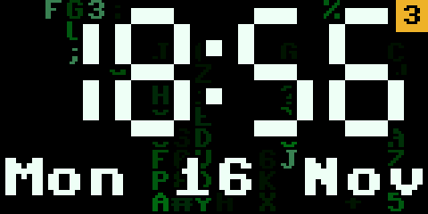
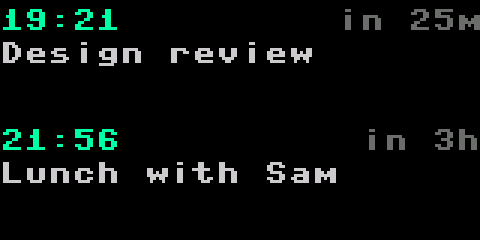
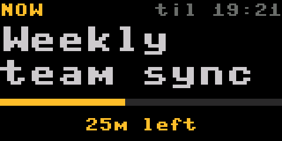
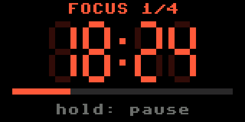
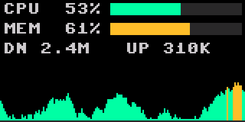
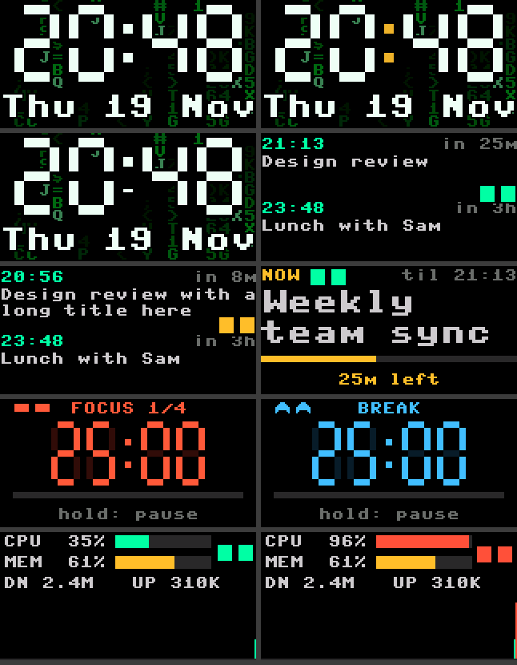
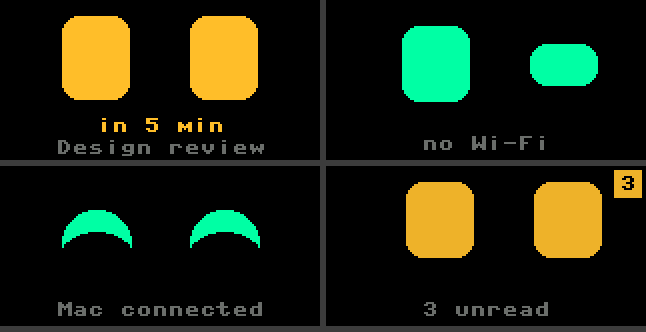

# ESP32 desk display

A small desk display built on the Spotpear ESP32-S3-0.96-SD board (ESP32-S3 with
a 160x80 colour LCD), written in MicroPython. It shows the time, your next
calendar events, a pomodoro timer and your Mac's vitals, and it has a face.

| Clock | Next events | Event in progress |
| --- | --- | --- |
|  |  |  |

| Pomodoro | Mac vitals |
| --- | --- |
|  |  |

These are captures of the board's 160x80 screen, enlarged three times, with sample data.

## Screens

| Screen | What it shows |
| --- | --- |
| Clock | HH:MM and the date over a "digital rain" backdrop, with a Slack unread badge in the corner |
| Agenda | The event in progress, large; otherwise the next two events |
| Pomodoro | 25-minute focus / 5-minute break timer, with a 15-minute break after every fourth round |
| Vitals | The Mac's CPU, memory and network activity, with a CPU history graph |

The clock and agenda alternate every 5 seconds. The BOOT button does the rest:

- **Short press:** clock/agenda → pomodoro → vitals → clock.
- **Long press** on the pomodoro: start or pause. Hold 2.5 seconds to reset.
- **Long press** on the clock or agenda: sync time and calendar now.

## The face

The display has a pair of eyes with a mood, so it reacts to what is going on
instead of only showing it.



- **Clock:** the colon is the eyes. It blinks and takes the mood's colour.
- **Agenda, pomodoro, vitals:** a small pair of eyes sits in a corner, blinking and
  glancing around. Pressing the button makes it wink.
- **Pop-ups:** the full face takes the screen for a few seconds when something
  happens, then hands it back. Any button press dismisses it.



| Mood | When | Look |
| --- | --- | --- |
| Stressed | Mac CPU at 85% or more | Red, trembling |
| Slack | Unread messages | Yellow |
| Focus | Pomodoro focus running | Red, narrowed |
| Break | Pomodoro break running | Blue, happy |
| Asleep | 11 pm to 7 am | Dim, closed |

| Pop-up | Trigger |
| --- | --- |
| "hello!" | Power-on |
| "3 unread" | A new Slack message |
| "in 5 min" + event title | A timed event is five minutes away |
| "break time!" / "next round?" | A pomodoro focus or break ends |
| "Mac connected" / "Mac?" | `mac_vitals.py` connects or goes quiet |
| "no Wi-Fi" | Time sync fails (once per outage) |

## How it gets its data

- **Time:** NTP over Wi-Fi. If Wi-Fi sync fails, it takes the time from the Mac over USB.
- **Calendar:** a private iCal link (for example Google Calendar's "secret address"),
  downloaded over Wi-Fi every 15 minutes. Repeating events and time zones are handled.
- **Mac vitals and Slack:** `mac_vitals.py` runs on the Mac and sends them over the USB cable.

## Files

| File | Runs on | Purpose |
| --- | --- | --- |
| `main.py` | Board | Display driver, screens, button, Wi-Fi sync |
| `agenda.py` | Board | Calendar download and parsing |
| `wifi_config.example.py` | Board | Template for your settings |
| `mac_vitals.py` | Mac | Sends vitals, time and Slack state to the board |

## Setup

### 1. Flash MicroPython

This replaces the firmware the board shipped with. You need
[esptool](https://docs.espressif.com/projects/esptool/) and
[mpremote](https://docs.micropython.org/en/latest/reference/mpremote.html):

```bash
pip install esptool mpremote
```

1. Download the MicroPython firmware for the board from
   [micropython.org/download/ESP32_GENERIC_S3](https://micropython.org/download/ESP32_GENERIC_S3/).
   Pick the **4 MB flash** variant (`ESP32_GENERIC_S3-FLASH_4M-...bin`); this
   project was built on v1.25.0.
2. Plug the board in and find its port:

   ```bash
   ls /dev/cu.usbmodem*
   ```

   If esptool cannot connect in the steps below, put the board in download mode:
   hold BOOT, press and release the reset button, then release BOOT.
3. Optional but recommended: back up what is on the board now, so you can go back.

   ```bash
   esptool --port /dev/cu.usbmodemXXXX read-flash 0 0x400000 original-flash.bin
   ```

4. Erase the flash and write MicroPython at address 0:

   ```bash
   esptool --port /dev/cu.usbmodemXXXX erase-flash
   ```

   ```bash
   esptool --port /dev/cu.usbmodemXXXX write-flash 0 ESP32_GENERIC_S3-FLASH_4M-20250415-v1.25.0.bin
   ```

5. Press the reset button. The port name may change after this, so list the
   ports again. Check that MicroPython answers:

   ```bash
   mpremote exec "import sys; print(sys.version)"
   ```

To restore the backup later, write it back the same way:
`esptool --port /dev/cu.usbmodemXXXX write-flash 0 original-flash.bin`.

The command names above are for esptool v5. Older versions use `esptool.py` with
underscores (`read_flash`, `erase_flash`, `write_flash`).

### 2. Install the display

1. Copy `wifi_config.example.py` to `wifi_config.py` and fill in your Wi-Fi name,
   password, time zone and, if you want the agenda, your calendar's iCal link.
   The board only supports 2.4 GHz Wi-Fi. `wifi_config.py` is git-ignored; keep it that way.
2. Copy the files to the board and restart it:

   ```bash
   mpremote cp main.py agenda.py wifi_config.py :
   ```

   ```bash
   mpremote reset
   ```

3. For the vitals screen, Slack badge and USB time fallback, run this on the Mac
   and leave it running:

   ```bash
   python3 mac_vitals.py
   ```

   It uses only the Python standard library, finds the board by itself and
   reconnects after a reset or re-plug. Add `-v` to see what it sends.

`mac_vitals.py` holds the serial port, so stop it before using `mpremote` and
start it again afterwards.

## Slack badge

The badge shows the unread count: yellow for unread messages, red for mentions.
`mac_vitals.py` reads it from one of two places:

1. The title of a Slack tab open in Safari. macOS asks once for permission to
   control Safari.
2. If no Slack tab is open, the Dock badge of the Slack desktop app. This needs
   Accessibility permission for the app running the script (System Settings >
   Privacy & Security > Accessibility).

Neither route has been tested against a live Slack session yet, so the parsing
may need adjusting.

## Hardware notes

- LCD (ST7735S): MOSI 4, SCLK 5, CS 8, DC 6, RST 7, backlight on GPIO3.
- Button: BOOT on GPIO0. The second button is a hardware reset.
- The SD card slot is not used.
